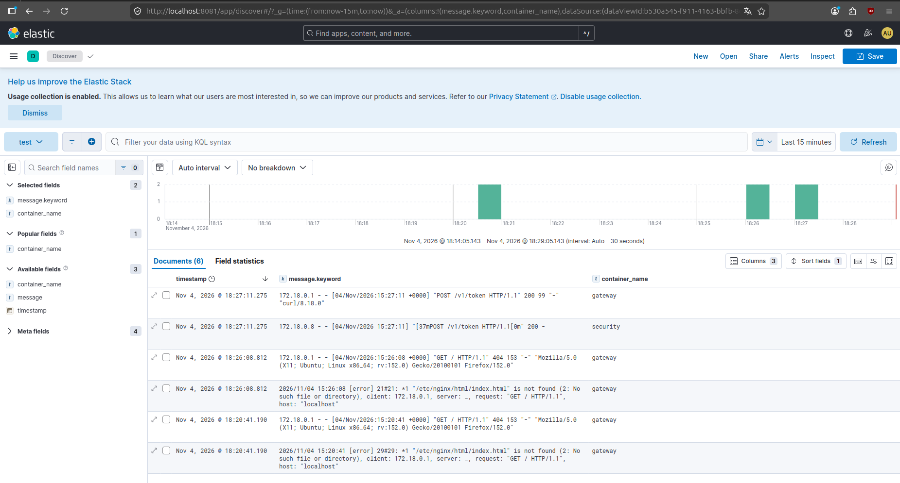
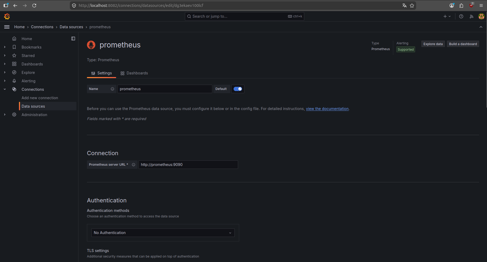
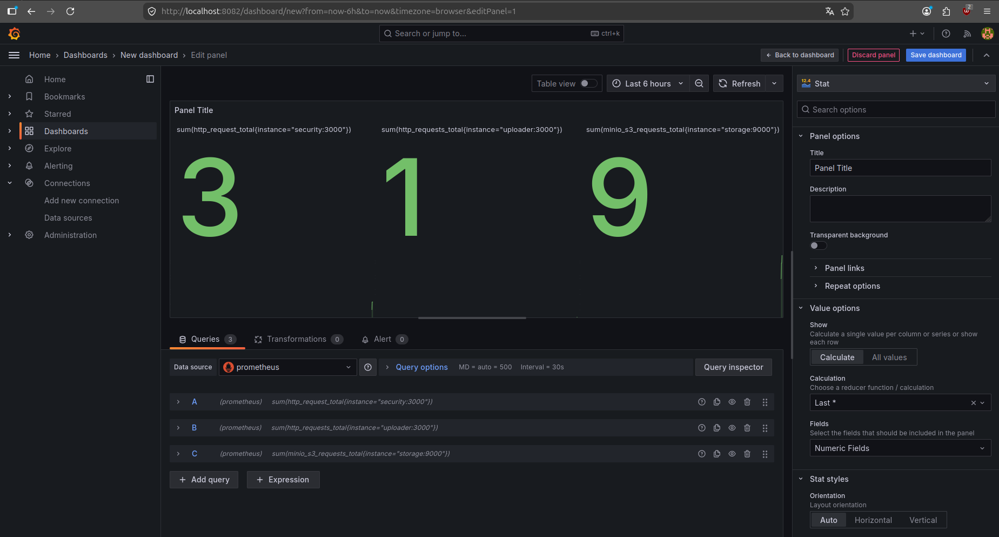

# Задача 1: Обеспечить разработку

Предлагаемое решение - GitLab + Hashicorp Vault

- Можно использовать как облачное решение (SaaS), так и резвернуть в своей инфраструктуре.
- Встроенная система контроля версий.
- Позволяет создать множество репозиториев, под каждый сервис.
- Поддерживает запуск сборки при наступлении событий, например, пуш в определенную ветку.
- Поддерживает запуск сборки по кнопке с указанием переменных.
- Можно привязать настройки к каждой сборке.
- Поддерживает механизм создания шаблонов сборок.
- Менее чувствительные секреты хранить в переменных сборки Gitlab, а критичные секреты - в Hashicorp Vault
- Поддерживает разные конфигурации сборок одного репозитория.
- Позволяет конфигурировать кастомные шаги при сборке, например, выполнение команд на агенте.
- Имеет возможность запускать собственные докер-образы для сборки.
- Позволяет подключить агентов сборки на собственных мощностях
- Можно запустить параллельно несколько сборок и тестов 


# Задача 2: Логи

Предлагаемое решение - Vector + ElasticSearch + Kibana

- Vector устанавливается на каждый хост для централизованного сбора логов
- Vector можно подключить для чтения stdout Docker-контейнеров и systemd демонов
- Vector гарантирует доставку логов за счет механизма "at-least-once", он обязуется доставить каждое сообщение до получателя, но в случае сбоев допускает появление дубликатов
- Kibana позволяет осуществлять поиск и фильтрации по записям логов
- Kibana является веб интерфейсом, доступ к которому можно настраивать: создавать новые учетные записи и ограничивать им достп в системе
- Kibana имеет возможность поделиться ссылкой на результат поиска 


# Задача 3: Мониторинг

Предлагаемое решение - Prometheus + Grafana + Telegraf

- Telegraf, установленный на каждый хост системы, позволяет собрать стандартные метрики ядра Linux, в частности CPU, RAM, HDD, Network, а затем открывает порт для чтения этих метрик для Prometheus сервера.
- Для сбора данных из контейнеров (CPU, RAM, HDD, Network) можно также использовать Telegraf.
- Для сбора метрик, специфичных для каждого сервиса, на стороне разработки можно встроить в сервис Prometheus клиента, который откроет endpoint для вытягивания метрик. На стороне сервиса можно генерировать любые метрики, диктуемые бизнеслогикой работы.
- Для визуализации метрик и их агрегации предлагается использовать Grafana. Она поддерживает создание дашбордов, визуализаций, а также алертинга. 


# Задача 4: Логи * (необязательная)
В файл [docker-compose.yaml](11-microservices-02-principles/docker-compose.yaml) были внесены изменения по настройке системы логирования Vector + ElasticSearch + Kibana.

Ключевые заметки:
- Чтобы vector мог читать логи контейнеров, необходимо контейнеру Vector примонтировать сокет Docker-демона (в режиме read-only безопаснее).
- Для создания пользователя admin в Kibana был сделан sidecar контейнер `setup_elasticsearch`, который делает необходимый API-вызов в ElasticSearch.


Запуск:
```
docker compose --env-file .env up
```

Пример вывода:




# Задача 5: Мониторинг * (необязательная)

Были добавлены и настроены контенеры prometheus + grafana ([docker-compose.yaml](11-microservices-02-principles/docker-compose.yaml)).

Запуск:
```
docker compose --env-file .env up
```

Конечный сервер grafana доступен по адресу `http://localhost:8082`

Был добавлен источник данных с созданным контейнером prometheus:




Далее был создан дашборд и добавлена визуализация с распределением запросов по сервисам:

